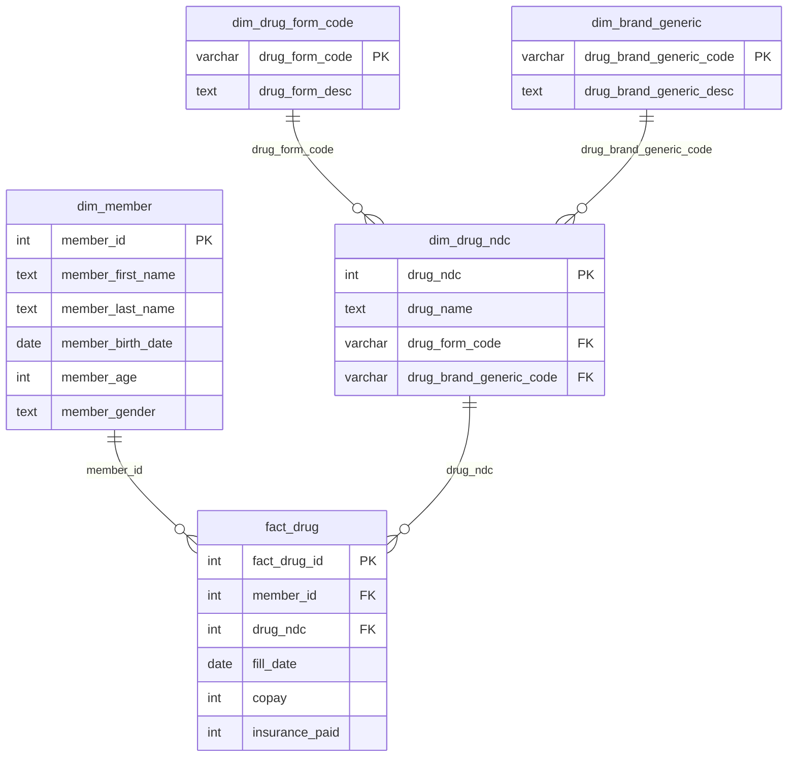

# 💊 Pharmacy Claims Data Warehouse

A MySQL data warehouse that turns a raw pharmacy claims spreadsheet into a normalized dimensional model (1 fact table, 4 dimension tables) and answers business questions about drug utilization, cost by age segment, and each member's most recent fill.

    

---

## 📌 Problem

A company is preparing to receive pharmacy claims files from its Pharmacy Benefit Manager (PBM) and needs a test warehouse to build and validate reports before the full production feed arrives. The sample file it received couldn't be used for reporting as-is: each row mixed member details, drug details, and up to three fills stored in repeating columns (`fill_date1/2/3`, `copay1/2/3`, `insurancepaid1/2/3`), so it wasn't even in first normal form.

## 🗃️ Data

- **Source:** fictional sample claims file provided for the course (no real patient data)
- **Size:** 4 members, 4 drugs (by National Drug Code), 11 prescription fills (2017–2018)
- **Files:** the five warehouse tables are in [`data/`](data/) as CSVs

## 🛠️ Approach

**1. Normalization (1NF → 3NF)**
- **1NF:** unpivoted the three repeating fill groups with `UNION ALL`, so each row is one fill event
- **2NF:** moved member attributes (depend only on `member_id`) and drug attributes (depend only on `drug_ndc`) into their own dimensions
- **3NF:** split dosage form and brand/generic descriptions into lookup tables, removing transitive dependencies

**2. Keys and referential integrity**
- Surrogate key on the fact table (`fact_drug_id`, auto-increment), natural keys on the dimensions
- Foreign keys with `ON DELETE RESTRICT` (no orphaned fills) and `ON UPDATE CASCADE` (key corrections flow through)

**3. Reporting queries:** joins, `CASE` segmentation, aggregation, a CTE, and a `ROW_NUMBER()` window function

**Fact table grain:** one row per prescription fill for a specific member and drug on a specific date. `copay` and `insurance_paid` are additive facts.

## 🧩 Data Model



The fact table joins directly to the member and drug dimensions, and the drug dimension links to the two small lookup tables (a star schema with the drug lookups snowflaked for 3NF).

## 📊 Results

**Drug utilization**

| Drug | Fills |
|---|:---:|
| Ambien | 5 |
| Risperidone | 3 |
| Diprosone | 2 |
| Amoxicillin | 1 |

**Cost by age segment**

| Segment | Fills | Members | Copay | Insurance paid |
|---|:---:|:---:|---:|---:|
| 65+ | 6 | 1 | $105 | $2,099 |
| Under 65 | 5 | 3 | $150 | $2,014 |

**Most recent fill per member:** for example, member 10003's latest fill was Ambien on 2018-05-16, with $322 paid by insurance.

## 💡 Key Insights

- **One senior member drives about half of insurance spend.** The single 65+ member accounts for 51% of the $4,113 total, a pattern worth monitoring at production scale.
- **The model is ready for the production feed.** Because each fill is its own row, the same design and queries work unchanged as file volume grows.

## 🧹 Data-Quality Fixes

While preparing this repo, I found two issues in the original pipeline and fixed them in [`sql/01_build_warehouse.sql`](sql/01_build_warehouse.sql):

1. **Empty fills counted as real fills.** The raw import stored missing fills as empty strings rather than `NULL`, so `WHERE fill_date IS NOT NULL` let 4 empty rows into the fact table. That inflated counts: Ambien showed 6 fills instead of 5. The build now excludes both `NULL` and empty values.
2. **Trailing spaces in names** (for example, `"David "` and `"Diprosone  "`) are now removed with `TRIM()`, so grouping and joins on names behave correctly.

The original course report in [`reports/`](reports/) shows the pre-fix figures.

## 📁 Repository Structure

```
├── data/        # the five warehouse tables as CSV
├── sql/
│   ├── 01_build_warehouse.sql   # normalization, keys, constraints
│   └── 02_analysis_queries.sql  # reporting queries with expected results
├── reports/     # original course report (PDF)
└── README.md
```

## ▶️ How to Run

1. Create a MySQL 8 database named `Pharmacy_Claims`.
2. Import the raw claims file as a table named `aly 6030 final project data set` (MySQL Workbench: *Table Data Import Wizard*).
3. Run `sql/01_build_warehouse.sql`, then `sql/02_analysis_queries.sql`.

To explore the finished model without the raw file, import the CSVs in `data/` directly.

---

**Jayesh Patil** · [LinkedIn](https://www.linkedin.com/in/jayeshp-242e/) · [GitHub](https://github.com/QuietSignal-hub)
